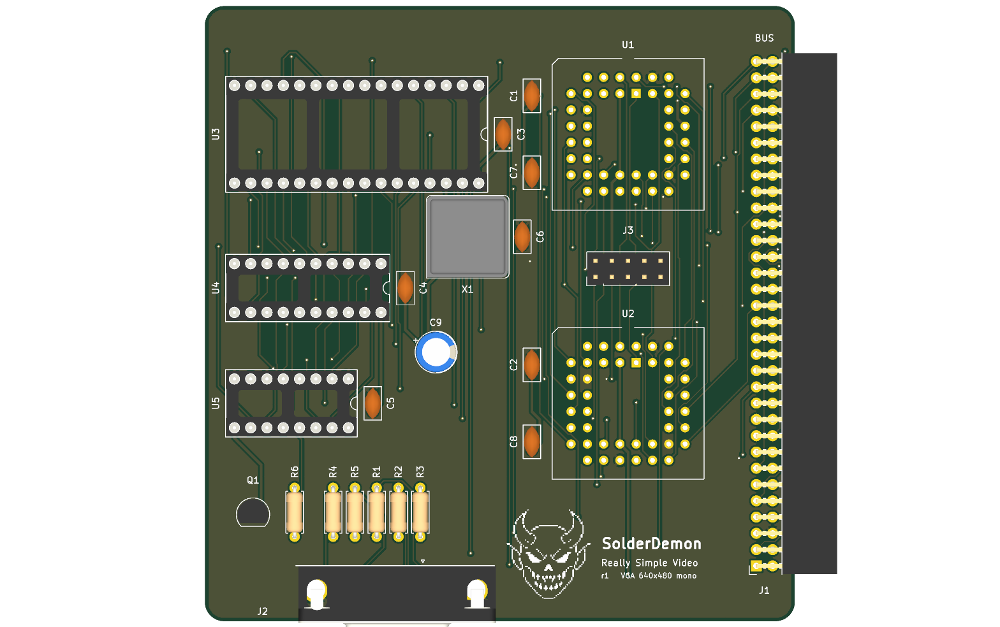
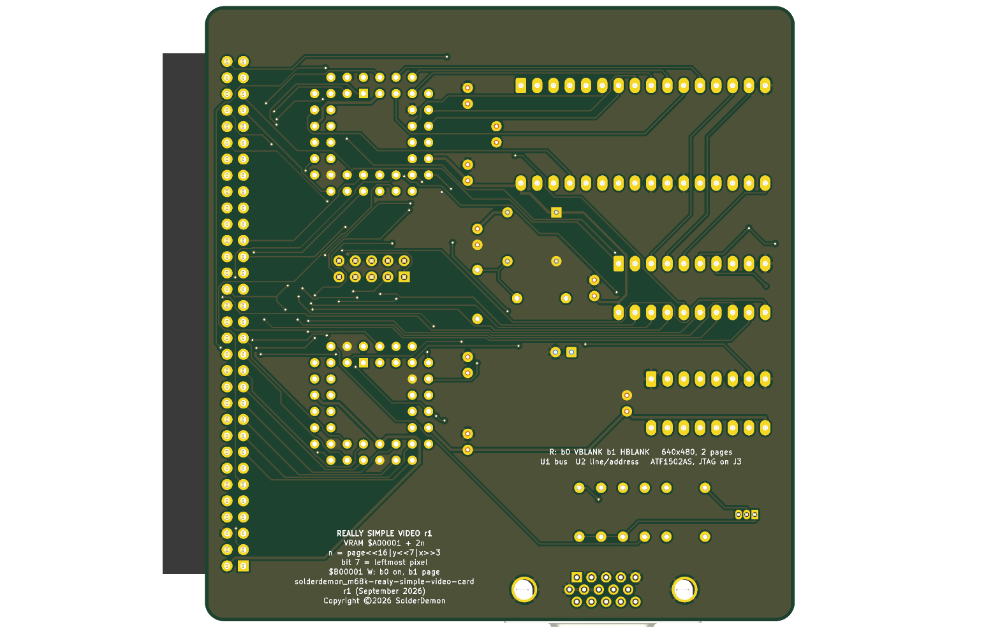

# SolderDemon m68k Really Simple Video

A SolderDemon m68k expansion card with a 640 × 480 monochrome framebuffer, 60 Hz VGA output, and two display pages. Two ATF1502AS CPLDs handle video timing, memory addressing, and the host interface.

J1 matches the expansion bus pinout of [rosco_m68k r2](https://github.com/rosco-m68k/rosco_m68k).

**Status.** r1 fabrication files and CPLD programming files are available. The CPLD fit and logic have been verified. Hardware verification is pending.

## Start here

- [KiCad project](design/solderdemon_m68k-realy-simple-video-card.kicad_pro)
- [Schematic (PDF)](manufacturing/solderdemon_m68k-realy-simple-video-card-schematic.pdf)
- [Gerbers and drill files](manufacturing/solderdemon_m68k-realy-simple-video-card-gerbers.zip)
- [Assembly and bring-up](docs/BRINGUP.md)

## Board views

| Top | Bottom |
|:---:|:---:|
|  |  |

## Features

| | |
|---|---|
| Picture | 640 × 480, 1 bit per pixel, two pages; 80 × 60 characters of 8 × 8 |
| Video signal | VGA, 31.25 kHz / 59.5 Hz from a 25.000 MHz can — VESA 640 × 480 @ 60 Hz geometry, 0.7 % slow |
| VRAM | `$A00001 + 2n`, byte n = page << 16 \| y << 7 \| x >> 3; byte access through `/LDS`, no wait states |
| Register | `$B00001` — write b0 video on, b1 page shown; read b0 VBLANK, b1 HBLANK |
| Logic | 2 × ATF1502AS-10JU44 (PLCC-44), one JTAG chain on `J3`; address multiplexer inside |
| Memory | one AS6C1008 128K SRAM, 55–100 ns |
| Data path | 74HCT245 transceiver, 74HC166 serialiser, 2N3904 video buffer |
| Power | 5 V from the bus, ~120–200 mA |
| Assembly | through-hole, every IC socketed; two CPLDs to program over JTAG |
| Size | 92 × 96 mm, 2 layers |

## Two CPLDs, five ICs

An ATF1502AS has 32 macrocells and, with JTAG left enabled, 28 I/O pins plus 4 dedicated inputs —
**32 usable signals**. An address multiplexer alone is 16 inputs plus 16 outputs: 32 pins before
any logic. The card therefore **splits the counters along with the multiplexer halves**, so that
no counter bit ever crosses between the two devices:

| | Holds | Drives | Pins | Macrocells |
|:---|:---|:---|:---:|:---:|
| **U1** | byte counter B, pixel phase, bus decode, control bit "video on", status | MA0–MA6, /HSYNC, /LOAD, /SEL, /SRAM_WE, /BUF_OE, /DTACK, D0, D1 | 32/32 | 30/32 |
| **U2** | line counter L, page register | MA7–MA16, /VSYNC, VBLANK | 30/32 | 30/32 |

Only three wires run between them: `SEL_N`, `LEND` (step the line counter) and `VBLANK`.

- **The control register is synchronous.** It is sampled on every 25 MHz clock while the write
  strobe is low, so it does not depend on the 68010's data hold time.
- **The address path is short.** The CPU's address reaches the SRAM through one CPLD (~10 ns),
  and the video address never leaves the chip that counts it.

## Display and memory

- **Video mode:** 640 × 480 @ 59.52 Hz, 31.250 kHz, exact VESA timing from a 25.000 MHz canned
  oscillator (`X1`) — 16/96/48 clock porches, VSYNC on lines 490-491; the clock leaves `X1`
  through two 33 Ω series resistors (`R7` to the CPLDs, `R8` to `U5`)
- **Framebuffer:** two pages of 480 × 128 bytes in one AS6C1008 (`U3`)
- **Direct CPU access:** VRAM at `$A00001 + 2n` (n = page << 16 | y << 7 | x >> 3), byte access
  through `/LDS`, zero wait states; the CPU reaches both pages at any time
- **Control & status:** one register at `$B00001` — write video on/off and the displayed page,
  read VBLANK and HBLANK
- **Programmable logic:** 2 × ATF1502AS-10JU44 (`U1`, `U2`) in one JTAG chain on `J3`
- **Data path:** 74HCT245 transceiver (`U4`), 74HC166 pixel serialiser (`U5`), `Q1` video emitter follower
- **Video output:** the pixel bit drives `Q1`, an emitter follower, which feeds R, G and B through
  390 Ω (`R1`–`R3`, ~0.67 V into 75 Ω); 47 Ω sync resistors (`R4`, `R5`) to a DE-15 HD socket
  (`J2`). Fit only `R2` for a green screen, `R1` + `R2` for amber — the brightness does not change
- **Power:** +5 V from the expansion bus, ~120–200 mA; 100 nF bypass at every IC (`C1`–`C8`),
  47 µF bulk capacitor (`C9`)
- **Form factor:** 92 × 96 mm 2-layer PCB, right-angle bus socket (`J1`) along the right edge

## Pinout

### J1 — SolderDemon m68k Expansion Bus (signals used by the card)

| Pin | Signal | Use | Pin | Signal | Use |
|:---:|:---|:---|:---:|:---|:---|
| **1–13 (odd)** | **A1–A7** | to U1, the low address half | **2** | **VCC** | +5 V supply |
| **15–33 (odd)** | **A8–A17** | to U2, the high address half | **6** | **GND** | Ground |
| **39** | **A20** | VRAM (0) / register (1) select | **18** | **~EXPSEL** | Expansion space select (includes `/AS`) |
| **41, 45** | **A21, A23** | Card window decode | **32** | **~LDS** | Byte data strobe |
| **61, 63, 64, 62** | **D0–D3** | Data bus via `U4` | **36** | **~RESET** | Clears the control register |
| **60, 58, 56, 54** | **D4–D7** | Data bus via `U4` | **59** | **R/~W** | Read / write |
| **57** | **~DTACK** | Pulled low by `U1` | | | |

A22 is not decoded (under `/EXPSEL` the only range with A23 and A21 set is `$A00000-$BFFFFF`), and
A18/A19 are unconnected, so the VRAM image repeats through `$A40000–$AFFFFF`.

### J2 — VGA (DE-15 HD, female)

| Pin | Signal | Description |
|:---:|:---|:---|
| **1, 2, 3** | **RED, GREEN, BLUE** | ~0.62 V into 75 Ω, all three from the same pixel bit |
| **13, 14** | **HSYNC, VSYNC** | Active low, 47 Ω series resistors |
| **5–8, 10, shell** | **GND** | Ground |
| **4, 9, 11, 12, 15** | — | Not connected (no DDC) |

### J3 — JTAG (Atmel 10-pin ISP)

| Pin | Signal | Pin | Signal |
|:---:|:---|:---:|:---|
| 1 | TCK | 2 | GND |
| 3 | TDO | 4 | VCC (+5 V) |
| 5 | TMS | 6–8 | not connected |
| 9 | TDI | 10 | GND |

The two devices sit in one chain: TDI → U1 → U2 → TDO.

### Memory map

| Address | R/W | Description |
|:---|:---:|:---|
| `$A00001 + 2n` | R/W | VRAM byte n = page << 16 \| y << 7 \| x >> 3 (128 bytes per row, 80 visible; bit 7 is the leftmost pixel) |
| `$B00001` | W | b0 video on, b1 page shown; system reset clears both (black screen, page 0) |
| `$B00001` | R | b0 VBLANK, b1 HBLANK (1 = in blanking); b2–b7 undefined, mask them |

The register repeats over `$B00001–$BFFFFF`. Even addresses in `$A00000–$BFFFFF` end in a bus
error. Any CPU access while the picture is on shows eight wrong pixels on the current scanline
("snow"), so draw on the hidden page and `video_flip()`, or draw inside VBLANK.

This window does not overlap `rosco_m68k-simple-video` (`$800000–$9FFFFF`), so both cards can sit
on the same backplane. Check it against your RAM expansion, which also lives in expansion space.

## Software

```c
#include "video.h"

video_init();                                   /* video off, page 0 */
video_clear(0);
video_text(2, 2, "SolderDemon m68k Really Simple Video");
video_rect(0, 0, 640, 480, 1);
video_show(0, true);

video_draw_page(1);                             /* draw on the hidden page... */
video_clear(0);
video_fill(100, 80, 96, 64, 1);
video_flip();                                   /* ...and show it at the next VBLANK */
```

Without the driver, `*(uint8_t *)(0xA00001 + (y << 8) + ((x >> 3) << 1)) |= 0x80 >> (x & 7);`
sets a pixel on page 0. The driver (`code/software/video.c/.h`) adds clipping, lines, fills, an 8 × 8
console font (80 × 60 characters), page flipping and a full VRAM self test; `code/software/main.c` is a
text-page and bouncing-box demo.

## Bill of Materials

| Reference | Value | Package / Footprint | Notes |
|:---|:---|:---|:---|
| **U1** | ATF1502AS-10JU44 | PLCC-44, THT socket | Bus, byte counter, MA0–MA6 — `code/firmware/cpld/rsv_u1.pld` |
| **U2** | ATF1502AS-10JU44 | PLCC-44, THT socket | Line counter, MA7–MA16, page — `code/firmware/cpld/rsv_u2.pld` |
| **U3** | AS6C1008-55PCN | DIP-32, 600 mil | 128K SRAM, 55–100 ns |
| **U4** | 74HCT245 | DIP-20 | Data bus transceiver |
| **U5** | 74HC166 | DIP-16 | Pixel serialiser |
| **X1** | 25.000 MHz | Oscillator DIP-8, 5 V | Canned oscillator (not a crystal) |
| **J1** | Conn_02x32 | PinSocket 2×32, 2.54 mm, Horizontal | SolderDemon m68k expansion bus |
| **J2** | DE-15 HD | DSUB-15-HD Socket, Horizontal | VGA output |
| **J3** | 2×5 pin header | 2.54 mm | Atmel JTAG / ISP |
| **Q1** | 2N3904 | TO-92 | Video emitter follower (BC547, BC337, 2N2222 all fine) |
| **R1–R3** | 390 Ω | Axial DIN0207, P7.62 mm | Video R, G, B |
| **R6** | 220 Ω | Axial DIN0207, P7.62 mm | Base resistor for Q1 |
| **R4, R5** | 47 Ω | Axial DIN0207, P7.62 mm | HSYNC / VSYNC series resistors |
| **R7, R8** | 33 Ω | Axial DIN0207, P7.62 mm | Clock series resistors at X1: R7 to the CPLDs, R8 to U5 |
| **C1–C8** | 100 nF | Radial 5.08 mm pitch | Bypass: two per CPLD, one per other IC, one at the oscillator |
| **C9** | 47 µF 10 V | Radial D6.3 mm, P2.5 mm | Bulk capacitor |
| — | Sockets | 2 × PLCC-44 THT, 1 × DIP-32 (600 mil), 1 × DIP-20, 1 × DIP-16, 1 × DIP-8 | Every IC is socketed |

You will also need a **JTAG programmer** — a USB Blaster clone is enough — and Microchip's WinCUPL
plus the ATF150x fitter.

The shift register stays discrete because neither CPLD has eight spare pins for MD0–MD7. It is an
ordinary **74HC166**: Nexperia specify that part at 40 MHz over the full temperature range at
4.5 V, so 25.000 MHz has plenty of margin.

Three 75 Ω monitor inputs want 9.3 mA each at full white, about 26 mA from one driver, and no
74HC/HCT output is rated for that (74HC166: IOH 4 mA, 20 mA absolute maximum). So `Q1` is an
emitter follower: U5 drives its base through `R6` at a few hundred microamps and `Q1` supplies the
current. `R1`–`R3` then set the level on their own, which is why leaving one out changes the
colour but not the brightness.

## Design files

- **KiCad project:** `design/solderdemon_m68k-realy-simple-video-card.kicad_pro` / `.kicad_sch` / `.kicad_pcb`
- **CPLD firmware:** [code/firmware/cpld/rsv_u1.pld](code/firmware/cpld/rsv_u1.pld), [code/firmware/cpld/rsv_u2.pld](code/firmware/cpld/rsv_u2.pld) —
  CUPL sources; they are also the single source of each CPLD's pinout, read by the generator and
  the simulator
- **Manufacturing outputs:** [manufacturing/](manufacturing) — Gerbers, drill file, placement
  file, schematic PDF, BOM
- **PCB specs:** 2 layers, 92 × 96 mm, 1.6 mm FR-4, 1 oz copper, 0.2 mm minimum track and
  clearance, 0.3 mm minimum hole, GND pour on both layers
- **Software:** [code/software/](code/software) — driver `video.c/.h`, font `font8x8.c`, demo `main.c`,
  Makefile; [code/tests/test_driver.c](code/tests/test_driver.c) host test
- **Generators:** [tools/](tools) — `build_card.py`, `route_card.py`, `sim_card.py` + `cupl.py`,
  `make_font.py`
- **Design documentation:** [docs/DESIGN.md](docs/DESIGN.md) (how the split works),
  [docs/BRINGUP.md](docs/BRINGUP.md) (programming, assembly, first power-up),
  [docs/BUILD.md](docs/BUILD.md) (regenerating everything)

## Verification

- **ERC:** 0 errors, 0 warnings ([erc.rpt](erc.rpt)).
- **DRC with schematic parity:** 0 violations at error *and* warning severity, 0 unconnected pads
  ([drc.rpt](drc.rpt)).
- **Routing:** 1154 tracks and vias, 68 vias, GND pour on both layers.
- **Netlist simulation** ([sim-verification.txt](sim-verification.txt), 31/31 pass): both counters
  run their full cycles and recover from all 128/1024 power-up states; the raster is 800 clocks ×
  525 lines with HSYNC at clocks 664–759 and VSYNC on lines 490–491; VRAM writes and reads on both
  pages; the control register split across the two chips, and the status read; `/DTACK` only
  inside the window; no bus contention. Two checks are specific to r1: **MA0..MA16 is compared
  against the expected address on every clock of a frame**, which is what proves the two address
  halves agree, and all 307200 pixels of a frame are compared with the SRAM, then again after a
  page flip. The simulator runs the real `.pld` files through `tools/cupl.py`.
- **CPLD fit** (`code/firmware/cpld/build.sh`, `code/firmware/cpld/bin/*.fit`, `*.jed`): both designs fit with every pin where
  the `.pld` — and therefore the PCB — puts it; U1 32/32 pins and 30/32 macrocells, U2 30/32 and
  30/32. `tools/check_fit.py` then compares the fitter's sum-of-products equations with the
  `cupl.py` model the simulation ran (every output, enable and next state, 200000 random vectors
  each): they match. This check found that CUPL reads `!FIELD:[lo..hi]` as "the complemented
  field is in range", which had turned both sync pulses into nonsense in the compiled logic while
  the simulation passed; the `.pld` files now write `!(FIELD:[..])` and `cupl.py` follows CUPL.
- **Driver** ([driver-verification.txt](driver-verification.txt), 31/31 pass): the real `video.c`
  against a model of the card, including the self test catching a stuck page address line.
- **NOT verified — read this before ordering a board:**
  - Timing has only been checked on paper, including the one-clock BUFD delay that lets the SRAM
    and the 74HCT245 share MD, and the LEND hand-off between the two chips.
  - No PCB has been manufactured; no build with the m68k toolchain; monitor compatibility unknown.

<!-- repository-layout -->
## Repository layout

- [`design/`](design/solderdemon_m68k-realy-simple-video-card.kicad_pro): KiCad project, schematic sheets, PCB, local libraries and design data. Open the project directly here.
- [`code/firmware/`](code/firmware/): ROM and programmable-logic sources and programming files.
- [`code/software/`](code/software/): drivers, examples and applications.
- [`code/build/`](code/build/): local build products; ignored by Git except for its README.
- [`tools/`](tools/): generators, simulations and export scripts. Run commands from the repository root unless stated otherwise.
- [`manufacturing/`](manufacturing/): fabrication packages.

Programmable-logic files are in `code/firmware/cpld/`. Native CPLD tools retain their adjacent `bin/` outputs.
Design files and documentation are generated by scripts in `tools/`; change the sources and regenerate. Keep `.kicad_pro` as the source of DRC rules.
<!-- /repository-layout -->

## Licence

Copyright © 2026 SolderDemon.

- **Hardware** — [CERN Open Hardware Licence v1.2](LICENCE.hardware.txt).
- **Documentation** — [Creative Commons Attribution 4.0](https://creativecommons.org/licenses/by/4.0/).

Third-party materials retain their original notices and licence terms.
